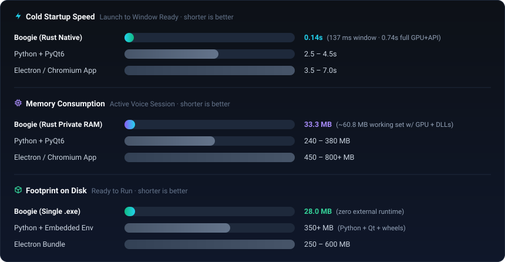
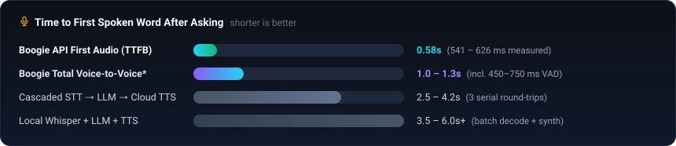
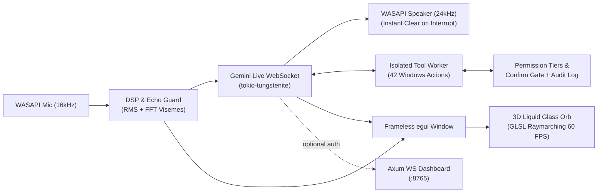

<div align="center">


# Boogie — Native Rust Voice AI Assistant

**Open-source, JARVIS-style real-time voice AI assistant & desktop AI agent for Windows — powered by Gemini Live API & a 60 FPS 3D Liquid Glass GLSL Orb.**

[](https://github.com/thodark/Boogie-AI-Assistant/releases/latest)
[](LICENSE)


<br />


</div>

---

## Why Rust? — Blazing Fast Startup & Tiny RAM Footprint

Boogie was rewritten from the ground up in **pure Rust** to eliminate interpreter overhead, PyQt/Chromium bloat, and sluggish cold starts — while delivering a **60 FPS raymarched 3D GPU interface**, **real-time screen vision**, and **42 native Windows automation tools** inside a single self-contained `.exe`.

### Visual Performance Comparison

> Measured on Windows 10/11 x64 (`target/release/boogie.exe`, active WASAPI audio streams + OpenGL 3D shader + Gemini Live TLS WebSocket).



### Real Measured Cold-Boot Timeline

| Stage | Elapsed Time | What Happens |
| :--- | :---: | :--- |
| **Process Launch** | `0 ms` | Native binary starts — zero VM/interpreter warmup |
| **WASAPI Audio Ready** | `28 ms` | Native mic (`16 kHz`) & speaker (`24 kHz`) opened via `cpal` |
| **GUI Window Live** | `137 ms` | Frameless Obsidian window visible on screen |
| **Gemini Live Connected** | `~520 ms` | TLS WebSocket `101 Switching Protocols` + session `setupComplete` |
| **3D GPU Orb Rendering** | `~740 ms` | Raymarched Liquid Glass GLSL shader compiled & running at **60 FPS** |

### Side-by-Side Specs

| Metric | Boogie (Rust) | Typical Python + PyQt6 | Typical Electron / WebView |
| :--- | :---: | :---: | :---: |
| **Window Ready** | **~137 ms** | ~2.5 – 4.5 s | ~3.5 – 7.0 s |
| **First Audio Response (TTFB)** | **~580 ms** (~1.0–1.3s w/ VAD) | ~2.2 – 4.5 s (STT→LLM→TTS) | ~2.5 – 5.0 s (STT→LLM→TTS) |
| **Private RAM** | **~33 MB** | ~240 – 380 MB | ~450 – 800+ MB |
| **Total Working Set** | **~61 MB** | ~300 – 450 MB | ~550 – 1,000+ MB |
| **Executable Size** | **28.0 MB** (1 file) | 350+ MB (folder) | 250 – 600 MB (folder) |
| **Runtime Needed** | **None** | Python + Qt DLLs | Bundled Chromium + Node |
| **3D Visuals** | **60 FPS GLSL Shader** | CPU / QPainter | WebGL (high RAM) |

---

## Response Speed — Real-Time Voice-to-Voice Latency

Instead of chaining three slow stages (**Speech-to-Text → Chat LLM → Text-to-Speech**), Boogie streams raw 16 kHz WASAPI microphone audio directly over a persistent TLS WebSocket to **Gemini Live Native Audio** and plays incoming 24 kHz audio chunks the instant the first packet arrives.

### Visual Response Latency Comparison

> Measured live on Windows x64 (`models/gemini-3.1-flash-live-preview`, persistent WebSocket session across conversational turns: **541 ms / 572 ms / 626 ms** → **~580 ms avg** to first audio byte).



> \*Total voice-to-voice time includes natural end-of-speech silence detection so Boogie never cuts off the last syllable of your sentence.

### Step-by-Step Response Pipeline Breakdown

| Stage | Latency | What Happens Under the Hood |
| :--- | :---: | :--- |
| **1. Local Rust Capture & DSP** | **`< 2 ms`** | WASAPI captures 16 kHz mono PCM, runs anti-alias resampling, RMS level & Echo Guard (`echo.rs`), and streams frames immediately — zero Python GIL or batch buffering |
| **2. End-of-Speech Detection** | **`450 – 750 ms`** | `450 ms` speech hangover streams trailing syllables for server-side VAD; explicit `audioStreamEnd` fires at `750 ms` if server VAD hasn't already closed the turn |
| **3. Gemini Live First Audio** | **`~580 ms`** | Native audio-to-audio streaming over persistent TLS WebSocket — **zero separate STT or TTS round-trips** (`541 – 626 ms` measured) |
| **4. Speaker & 3D Orb Sync** | **`< 15 ms`** | First 24 kHz PCM chunk is FFT-analyzed for visemes (`dsp.rs`) and pushed straight to the WASAPI ring buffer while the 3D orb morphs into `Speaking` |
| **5. Instant Barge-In / Stop** | **`< 20 ms`** | Speaking over Boogie or clicking Interrupt fires `PlaybackCmd::Clear`, flushing the speaker buffer immediately without waiting for the server |
| **6. Native Local Tools** | **`~15 – 150 ms`** | Non-blocking Rust worker executes `open_app` (Win32 window focus / Start Menu / Registry), `open_url`, or system controls in parallel with a hard `25 s` timeout guard |

---

## Key Features

### 1. Real-Time 3D Liquid Glass / Ferrofluid Orb (`orb_shader.rs`)
- **Pure OpenGL GLSL Raymarching** directly inside `eframe::glow` — zero heavy 3D engine bloat.
- **Audio & Viseme Reactive:** Real-time FFT speech analysis (`dsp.rs` — energy level, vowel openness, and formant width) drives liquid surface waves and internal refracted plasma ribbons at 60 FPS.
- **Smooth State Morphing:** Fluidly blends palette, turbulence, and 3D tilted orbital ring across `Listening` (Violet/Cyan), `Speaking` (Cyan/Mint), `Thinking` (Violet/Amber), `Sleeping`, and `Muted`.
- **Interactive 3D:** Subtle cursor parallax tilts lighting and camera; clicking the orb triggers a liquid energy pulse.

### 2. Modern Frameless Obsidian UI (`gui.rs`)
- **Custom Frameless Window:** Native Neon Boogie app icon (window, taskbar & `.exe`), ultra-slim draggable header, 8-edge resizing, live pulsing status pill (`LISTENING`, `SPEAKING`, `THINKING`, `HOLD SPACE` / `PTT LIVE`, `MUTED`), accurate CPU/RAM telemetry, error banners, and crisp vector window controls.
- **First-Run Onboarding & In-App Settings Modal:** Launch without manual JSON editing, and reopen **Settings** anytime via the top-right gear button — hot-reload your Gemini API key, voice, assistant/user name, mic/speaker devices, Push-to-Talk (`Space`), and proactive check-ins live without restarting.
- **Live Captions + Frosted Glass Drawer:** Clean centered subtitles fade gently below the orb; click captions or the History button to slide up a frosted glass conversation drawer with smart word-wrapped bubbles, merged streaming sentences, and compact tool chips (`⚡ Computer Settings · brightness down`).
- **Floating Glass Control Dock:** Centered pill dock with Mute toggle, 14-bar live spectrum visualizer, instant Interrupt/Stop button, and Conversation Drawer toggle.

### 3. Resilient Voice Pipeline & Real Screen Vision
- **Native WASAPI Audio (`audio.rs`) + Hardware-Aware Echo Guard (`echo.rs`):** Multi-format (`f32`/`i16`/`u16`) capture & playback with anti-alias resampling, a 180-second mono speaker ring buffer (prevents skipping on fast, multi-minute Gemini bursts), instant speaker buffer clearing (`< 20 ms`) on barge-in or server `interrupted`, 450ms speech hangover + pre-response echo guard reset, `audio/pcm;rate=16000`, and `audioStreamEnd` signaling.
- **Resilient Gemini Live Client (`gemini.rs`, `main.rs`):** Per-session non-blocking background tool worker with 25s timeout & panic isolation, 20s WebSocket keepalive pings, response-only stall watchdog (never falsely disconnects during quiet listening), turn-safe deferred `goAway` & 14-minute session rotation (never cuts off mid-sentence), exponential reconnect backoff, persistent `boogie.log` diagnostics, and long-term session summary recall.
- **Native App Launcher (`open_app.rs`) & Fast Browser Control (`browser.rs`):** Resolves & focuses/launches any installed Windows app via Win32 window enumeration, Start Menu `.lnk` shortcuts, Windows Registry `App Paths`, `PATH`, URI schemes, and UWP `Get-StartApps`; opens URLs directly in your default or requested browser (`brave`, `chrome`, `edge`, `firefox`) without hanging.
- **Real Screen & Browser Vision (`screen_process`, `browser_control` `screenshot`):** Captures monitors or Chromium pages, resizes to `≤1280px` JPEG, and streams directly into Gemini Live `realtimeInput.video`.

### 4. Security-First Automation (42 Native Windows Tools)
- **Permission Tiers & Confirmation Gate (`confirm.rs`):**
  - `run_command` auto-runs only a strict read-only single-command allowlist (blocking shell chaining `&&`, `;`, `|`, `>`); all mutating commands require on-screen approval.
  - `send_message`, `kill_process` (exact match + numeric PID + protected system process blocklist), `write_file`, `delete_file`, `move_file`, and destructive `computer_settings` require explicit confirmation with request-ID matching (no stale approvals).
  - All confirmed/denied sensitive actions are recorded in `~/.boogie/audit.log`.
- **Prompt Injection Defense (`util.rs`):** External outputs (`web_scrape`, `web_search`, `read_file`, `read_pdf`, `read_excel`, `clipboard_read`, browser text) are wrapped in `<<<UNTRUSTED source=...>>>` markers and automatically escalate desktop input actions in the same turn to require confirmation.
- **Network & Process Hardening:** SSRF protection blocking loopback/LAN/link-local targets, 15s shared HTTP timeout, Chromium sandbox kept enabled, script/executable launch blocking, and local WebSocket dashboard (`:8765`) disabled by default with Origin checks + random token auth when enabled.

---

## Architecture



---

## Quick Start

### Option A: Download Prebuilt Binary (Recommended — No Rust Required)
1. Download **`Boogie-Windows-x64.zip`** (or standalone `boogie.exe`) from [**GitHub Releases**](https://github.com/thodark/Boogie-AI-Assistant/releases/latest).
2. Extract anywhere and launch `boogie.exe` — paste your **Google Gemini API key** in the built-in Setup screen.

### Option B: Build from Source

#### Prerequisites
- **Windows 10 / 11 (64-bit)**
- **Rust toolchain** (Edition 2024 — Rust 1.85+ via [rustup.rs](https://rustup.rs))
- A **Google Gemini API key** with Gemini Live API access

```powershell
git clone https://github.com/thodark/Boogie-AI-Assistant.git
cd Boogie-AI-Assistant
cargo build --release
.\target\release\boogie.exe
```

### Configuration (Optional Manual Setup)

When launched without config, Boogie opens the **built-in Setup screen** (and you can edit any setting anytime via the top-right **Settings** gear icon). To pre-configure manually, copy `config/api_keys.example.json` to `config/api_keys.json` next to `boogie.exe` (also searched in `./config/api_keys.json` and `%APPDATA%\Boogie\api_keys.json`):

```json
{
  "gemini_api_key": "YOUR_GEMINI_API_KEY_HERE",
  "model": "models/gemini-3.1-flash-live-preview",
  "api_version": "v1alpha",
  "assistant_name": "Boogie",
  "user_name": "",
  "voice": "Aoede",
  "input_device": "",
  "output_device": "",
  "push_to_talk": false,
  "proactive_audio": true,
  "dashboard_enabled": false
}
```

> **Tip:** Runtime diagnostics are automatically saved to `boogie.log` alongside `api_keys.json`. Set `RUST_LOG=boogie=debug` for verbose trace logging (defaults to `boogie=info`).

---

## Project Structure

```text
.
├── .github/workflows/
│   ├── ci.yml                  # Formatting, Clippy & unit test CI on Windows
│   └── release.yml             # Automated Windows release build on v* tags
├── Cargo.toml                  # Dependencies & binary target
├── Cargo.lock                  # Reproducible dependency lockfile
├── LICENSE                     # MIT License
├── build.rs                    # Embeds Windows .exe icon (assets/logo.ico)
├── assets/
│   ├── logo.png                # Brand logo
│   ├── logo_icon.png           # 256px embedded window/header icon
│   ├── logo.ico                # Multi-res Windows executable icon
│   ├── boogie.rc               # Windows icon resource definition
│   ├── screenshot.png          # UI showcase screenshot
│   ├── social_preview.png      # Open Graph / GitHub Social Preview banner (1280x640)
│   ├── perf_comparison.svg     # Vector performance comparison chart
│   └── latency_comparison.svg  # Vector voice latency comparison chart
├── core/
│   └── prompt.txt              # Embedded system prompt (overridable externally)
├── config/
│   └── api_keys.example.json   # Config template
└── src/
    ├── main.rs                 # Supervisor, non-blocking tool worker & session loop
    ├── gui.rs                  # Frameless Obsidian UI, onboarding, captions, drawer & dock
    ├── orb_shader.rs           # 60 FPS 3D Liquid Glass / Ferrofluid GLSL shader
    ├── gemini.rs               # Gemini Live API WebSocket client (audio + vision)
    ├── audio.rs                # Multi-format WASAPI audio + instant Clear playback
    ├── dsp.rs                  # RMS energy & FFT viseme extraction (rustfft)
    ├── echo.rs                 # Speaker-aware echo guard + hangover + audioStreamEnd
    ├── confirm.rs              # Permission tiers, confirm gate & audit logger
    ├── config.rs               # Multi-path config loader, prompt & session memory
    ├── proactive.rs            # Proactive check-in engine
    ├── dashboard.rs            # Authenticated local Axum WS server (off by default)
    ├── tools.rs                # Tool registry, vision frames & untrusted tagging
    ├── util.rs                 # UTF-8 safe truncation, SSRF guard, shared HTTP & JPEG
    └── actions/                # 17 modules implementing 42 native Windows tools (incl. open_app)
```

---

## Development & CI

```powershell
cargo fmt --all -- --check
cargo clippy --all-targets -- -D warnings
cargo test
```

GitHub Actions (`.github/workflows/ci.yml`) runs formatting, strict Clippy (`-D warnings`), and the full unit test suite automatically on `windows-latest`.

---

## Tech Stack

| Layer | Crate |
| :--- | :--- |
| **GUI & 3D Shader** | `eframe` / `egui` 0.31 + `glow` (OpenGL GLSL) |
| **Async Runtime** | `tokio` |
| **Audio I/O & DSP** | `cpal` (WASAPI), `rustfft` |
| **Realtime AI** | `tokio-tungstenite` (Gemini Live WebSocket) |
| **Windows Automation** | `windows` (`windows-rs`, Per-Monitor V2 DPI-aware), `screenshots`, `arboard`, `trash` |
| **Browser Control** | `chromiumoxide` (CDP, sandboxed), `reqwest`, `scraper` |
| **Security & Dashboard** | `ring` (random token auth), `url` (SSRF guard), `axum` |

---

## License

Licensed under the [MIT License](LICENSE).
