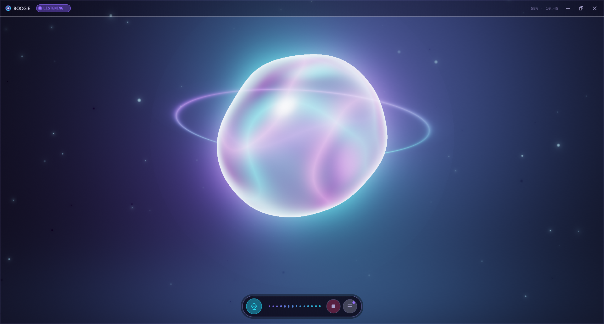
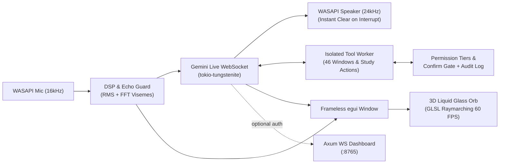

<div align="center">


# Boogie — Native Rust Voice AI Assistant

**Open-source, JARVIS-style real-time voice AI assistant & desktop AI agent for Windows — powered by Gemini Live API & a 60 FPS 3D Liquid Glass GLSL Orb.**

<br />

[](https://github.com/thodark/Boogie-AI-Assistant/releases/latest/download/Boogie-v0.4.0-Windows-x64.zip)
[](https://github.com/thodark/Boogie-AI-Assistant/releases/latest/download/Boogie-v0.4.0.exe)
[](https://thodark.github.io/Boogie-AI-Assistant/)

<sub>Windows 10 / 11 (64-bit) · <strong>No Rust, Cargo, or Python required</strong> · Portable single-file binary</sub><br />
<sub><a href="#download-for-windows">Download</a> · <a href="#first-time-setup-gemini-api-key">Gemini API Key Setup</a> · <a href="#verify-release-checksums-sha-256">SHA-256</a> · <a href="#changelog">Changelog</a> · <a href="#build-from-source-for-developers">Build from Source</a></sub>

<br />

[](https://github.com/thodark/Boogie-AI-Assistant/releases/latest)
[](LICENSE)


<br />



</div>

---

## Download for Windows

You do **not** need Rust, Cargo, Python, or any runtime to try Boogie. Download a prebuilt release from [**GitHub Releases**](https://github.com/thodark/Boogie-AI-Assistant/releases/latest) and run it directly on Windows 10 / 11 (64-bit):

| File | Size | Description | Download |
| :--- | :---: | :--- | :--- |
| **`Boogie-v0.4.0-Windows-x64.zip`** | `11.9 MB` | **Recommended** — `Boogie-v0.4.0.exe`, `config/api_keys.example.json`, `README.md`, `LICENSE` | [Download v0.4.0 ZIP](https://github.com/thodark/Boogie-AI-Assistant/releases/latest/download/Boogie-v0.4.0-Windows-x64.zip) |
| **`Boogie-v0.4.0.exe`** | `32.2 MB` | Standalone portable executable with embedded version metadata (single file, no install) | [Download v0.4.0 EXE](https://github.com/thodark/Boogie-AI-Assistant/releases/latest/download/Boogie-v0.4.0.exe) |
| **`SHA256SUMS.txt`** | `~200 B` | Official SHA-256 release checksums | [Download SHA256SUMS.txt](https://github.com/thodark/Boogie-AI-Assistant/releases/latest/download/SHA256SUMS.txt) |

### First-Time Setup: Gemini API Key

1. **Create a Gemini API key:** Open [**Google AI Studio — API Keys**](https://aistudio.google.com/apikey), sign in with your Google account, click **Create API key**, and copy the generated key (starts with `AIza...`). Boogie connects to the **Gemini Live API** (`models/gemini-3.1-flash-live-preview` by default).
2. **Launch `boogie.exe`:** Extract `Boogie-Windows-x64.zip` anywhere (or run the standalone `boogie.exe` directly).
   > **Windows SmartScreen notice:** Because this open-source binary is not yet signed with a paid EV code-signing certificate, Windows Defender SmartScreen may display *"Windows protected your PC"*. Verify the SHA-256 checksum below, then click **More info → Run anyway**.
3. **Complete the built-in Setup screen:** On first launch, Boogie automatically opens **BOOGIE SETUP — Connect Gemini Live API**:
   - Paste your `AIza...` key into **Gemini API Key** (use **Show** if you want to verify it).
   - Pick your **Graphics Quality** (`Low (Lite)` for weak/integrated GPUs, `Medium`, or `High (Ultra)`) and **Color Theme** (8 presets with live preview behind the modal).
   - *(Optional)* Choose a **Voice** (`Aoede`, `Charon`, `Kore`, `Fenrir`, `Puck`), set **Assistant Name** / **Your Name**, pick your **Mic** & **Speaker**, or toggle **Push-to-Talk (hold Space)** and **Proactive check-ins**.
   - Click **Save & Connect**. Boogie saves `api_keys.json` and your long-term memory persistently in `%APPDATA%\Boogie\` (so you can safely delete old Boogie folders when upgrading to a newer versioned release like `Boogie-v0.4.0.exe` without losing your API key, settings, or memories!). Your API key stays 100% on your PC and is only sent directly to Google's Gemini endpoints.
4. **Edit settings anytime:** Click the top-right **Settings** gear icon to live-preview and hot-reload your graphics tier, color theme, Study Visual toggle, Study Brain mode, API key, voice, audio devices, or Push-to-Talk — no restart or manual JSON editing required.

<details>
<summary><strong>Advanced: Manual JSON Configuration, Upgrade Persistence & Runtime Logs</strong></summary>

By default, Boogie stores your user data (`api_keys.json`, `memory.json`, `long_term.json`, `boogie.log`) in `%APPDATA%\Boogie\` and automatically migrates legacy `v0.1–v0.3` files from `<exe_dir>\config\` on first run. Place an empty `portable.txt` next to the `.exe` only if you explicitly want USB-portable local storage inside `<exe_dir>\config\`.

Search order in normal mode:
1. `%APPDATA%\Boogie\api_keys.json` *(persistent across folder deletions & version upgrades)*
2. `<exe_dir>\config\api_keys.json`
3. `.\config\api_keys.json`

```json
{
  "gemini_api_key": "YOUR_GEMINI_API_KEY_HERE",
  "model": "models/gemini-3.1-flash-live-preview",
  "api_version": "v1alpha",
  "assistant_name": "Boogie",
  "user_name": "",
  "voice": "Aoede",
  "input_device": "",
  "output_device": "",
  "push_to_talk": false,
  "proactive_audio": true,
  "dashboard_enabled": false,
  "graphics_quality": "high",
  "color_theme": "obsidian",
  "auto_memory_consolidation": true,
  "memory_model": "gemini-2.5-flash-lite",
  "study_brain": "auto",
  "study_visual_enabled": true
}
```

> **Diagnostics:** Runtime logs are saved to `boogie.log` alongside `api_keys.json`. Set `RUST_LOG=boogie=debug` for verbose trace logging (defaults to `boogie=info`).

</details>

### Verify Release Checksums (SHA-256)

Official checksums are published in [`SHA256SUMS.txt`](https://github.com/thodark/Boogie-AI-Assistant/releases/latest/download/SHA256SUMS.txt) alongside every GitHub Release. Verify locally in PowerShell before running:

```powershell
Get-FileHash .\Boogie-v0.4.0-Windows-x64.zip -Algorithm SHA256
# or for the standalone executable:
Get-FileHash .\Boogie-v0.4.0.exe -Algorithm SHA256
```

---

## Why Rust? — Blazing Fast Startup & Tiny RAM Footprint

Boogie was rewritten from the ground up in **pure Rust** to eliminate interpreter overhead, PyQt/Chromium bloat, and sluggish cold starts — while delivering a **60 FPS raymarched 3D GPU interface**, **interactive split-screen Study Visual teaching & Art Study board**, **PDF/Word/Excel Document Studio**, and **46 native Windows automation tools** inside a single self-contained `.exe`.

### Visual Performance Comparison

> Measured on Windows 10/11 x64 (`target/release/boogie.exe`, active WASAPI audio streams + OpenGL 3D shader + Gemini Live TLS WebSocket).


### Real Measured Cold-Boot Timeline

| Stage | Elapsed Time | What Happens |
| :--- | :---: | :--- |
| **Process Launch** | `0 ms` | Native binary starts — zero VM/interpreter warmup |
| **WASAPI Audio Ready** | `28 ms` | Native mic (`16 kHz`) & speaker (`24 kHz`) opened via `cpal` |
| **GUI Window Live** | `137 ms` | Frameless Obsidian window visible on screen |
| **Gemini Live Connected** | `~520 ms` | TLS WebSocket `101 Switching Protocols` + session `setupComplete` |
| **3D GPU Orb Rendering** | `~740 ms` | Raymarched Liquid Glass GLSL shader compiled & running at **60 FPS** |

### Side-by-Side Specs

| Metric | Boogie (Rust) | Typical Python + PyQt6 | Typical Electron / WebView |
| :--- | :---: | :---: | :---: |
| **Window Ready** | **~137 ms** | ~2.5 – 4.5 s | ~3.5 – 7.0 s |
| **First Audio Response (TTFB)** | **~580 ms** (~1.0–1.3s w/ VAD) | ~2.2 – 4.5 s (STT→LLM→TTS) | ~2.5 – 5.0 s (STT→LLM→TTS) |
| **Private RAM** | **~33 MB** | ~240 – 380 MB | ~450 – 800+ MB |
| **Total Working Set** | **~61 MB** | ~300 – 450 MB | ~550 – 1,000+ MB |
| **Executable Size** | **28.8 MB** (1 file) | 350+ MB (folder) | 250 – 600 MB (folder) |
| **Runtime Needed** | **None** | Python + Qt DLLs | Bundled Chromium + Node |
| **3D Visuals** | **60 FPS GLSL Shader** | CPU / QPainter | WebGL (high RAM) |

---

## Response Speed — Real-Time Voice-to-Voice Latency

Instead of chaining three slow stages (**Speech-to-Text → Chat LLM → Text-to-Speech**), Boogie streams raw 16 kHz WASAPI microphone audio directly over a persistent TLS WebSocket to **Gemini Live Native Audio** and plays incoming 24 kHz audio chunks the instant the first packet arrives.

### Visual Response Latency Comparison

> Measured live on Windows x64 (`models/gemini-3.1-flash-live-preview`, persistent WebSocket session across conversational turns: **541 ms / 572 ms / 626 ms** → **~580 ms avg** to first audio byte).


> \*Total voice-to-voice time includes natural end-of-speech silence detection so Boogie never cuts off the last syllable of your sentence.

### Step-by-Step Response Pipeline Breakdown

| Stage | Latency | What Happens Under the Hood |
| :--- | :---: | :--- |
| **1. Local Rust Capture & DSP** | **`< 2 ms`** | WASAPI captures 16 kHz mono PCM, runs anti-alias resampling, RMS level & Echo Guard (`echo.rs`), and streams frames immediately — zero Python GIL or batch buffering |
| **2. End-of-Speech Detection** | **`450 – 750 ms`** | `450 ms` speech hangover streams trailing syllables for server-side VAD; explicit `audioStreamEnd` fires at `750 ms` if server VAD hasn't already closed the turn |
| **3. Gemini Live First Audio** | **`~580 ms`** | Native audio-to-audio streaming over persistent TLS WebSocket — **zero separate STT or TTS round-trips** (`541 – 626 ms` measured) |
| **4. Speaker & 3D Orb Sync** | **`< 15 ms`** | First 24 kHz PCM chunk is FFT-analyzed for visemes (`dsp.rs`) and pushed straight to the WASAPI ring buffer while the 3D orb morphs into `Speaking` |
| **5. Instant Barge-In / Stop** | **`< 20 ms`** | Speaking over Boogie or clicking Interrupt fires `PlaybackCmd::Clear`, flushing the speaker buffer immediately without waiting for the server |
| **6. Native Local Tools** | **`~15 – 150 ms`** | Non-blocking Rust worker executes `open_app` (Win32 window focus / Start Menu / Registry), `open_url`, or system controls in parallel with a hard `25 s` timeout guard |

---

## Key Features

### 1. Real-Time 3D Liquid Glass / Ferrofluid Orb (`orb_shader.rs`, `theme.rs`)
- **Pure OpenGL GLSL Shaders with 3 Performance Tiers:** Choose **High (Ultra)** (60 FPS, 64-step 3D raymarching), **Medium** (45 FPS, 28-step balanced raymarching, ~3–4× lighter), or **Low (Lite)** (30 FPS analytical 3D Liquid Glass sphere with live ripples, plasma core & orbital ring — ~15× lighter for weak/integrated GPUs) right in Setup or Settings with instant live preview.
- **8 Curated Color Themes:** Switch live between **Neon Obsidian**, **Aurora Prism** (animated iridescent rainbow), **Cyber Sakura**, **Solar Flare**, **Emerald Pulse**, **Arctic Frost**, **Crimson Phantom**, and **Vaporwave Neon** — tinting both the 3D orb and the entire Obsidian UI smoothly.
- **Audio & Viseme Reactive:** Real-time FFT speech analysis (`dsp.rs` — energy level, vowel openness, and formant width) drives liquid surface waves and internal refracted plasma ribbons.
- **Interactive 3D:** Subtle cursor parallax tilts lighting and camera; clicking the orb triggers a liquid energy pulse.

### 2. Modern Frameless Obsidian UI (`gui.rs`)
- **Custom Frameless Window:** Native Neon Boogie app icon (window, taskbar & `.exe`), ultra-slim draggable header, 8-edge resizing, live pulsing status pill (`LISTENING`, `SPEAKING`, `THINKING`, `HOLD SPACE` / `PTT LIVE`, `MUTED`), accurate CPU/RAM telemetry, error banners, and crisp vector window controls.
- **First-Run Onboarding & In-App Settings Modal:** Launch without manual JSON editing, and reopen **Settings** anytime via the top-right gear button — hot-reload your Gemini API key, voice, assistant/user name, mic/speaker devices, Push-to-Talk (`Space`), and proactive check-ins live without restarting.
- **Live Captions + Frosted Glass Drawer:** Clean centered subtitles fade gently below the orb; click captions or the History button to slide up a frosted glass conversation drawer with smart word-wrapped bubbles, merged streaming sentences, and compact tool chips (`⚡ Computer Settings · brightness down`).
- **Floating Glass Control Dock:** Centered pill dock with Mute toggle, 14-bar live spectrum visualizer, instant Interrupt/Stop button, and Conversation Drawer toggle.

### 3. Resilient Voice Pipeline & Real Screen Vision
- **Native WASAPI Audio (`audio.rs`) + Hardware-Aware Echo Guard (`echo.rs`):** Multi-format (`f32`/`i16`/`u16`) capture & playback with anti-alias resampling, a 180-second mono speaker ring buffer (prevents skipping on fast, multi-minute Gemini bursts), instant speaker buffer clearing (`< 20 ms`) on barge-in or server `interrupted`, 450ms speech hangover + pre-response echo guard reset, `audio/pcm;rate=16000`, and `audioStreamEnd` signaling.
- **Resilient Gemini Live Client (`gemini.rs`, `main.rs`):** Per-session non-blocking background tool worker with 25s timeout & panic isolation, 20s WebSocket keepalive pings, response-only stall watchdog (never falsely disconnects during quiet listening), turn-safe deferred `goAway` & 14-minute session rotation (never cuts off mid-sentence), exponential reconnect backoff, persistent `boogie.log` diagnostics, and long-term session summary recall.
- **Native App Launcher (`open_app.rs`) & Fast Browser Control (`browser.rs`):** Resolves & focuses/launches any installed Windows app via Win32 window enumeration, Start Menu `.lnk` shortcuts, Windows Registry `App Paths`, `PATH`, URI schemes, and UWP `Get-StartApps`; opens URLs directly in your default or requested browser (`brave`, `chrome`, `edge`, `firefox`) without hanging.
- **Real Screen Vision, Ultra-Fast Study Brain & Zero-Quota Study Visual Board (`screen_process`, `study_solve`, `study_board`):** Fires a crisp **camera shutter beep (~25 ms)** the instant screen pixels are safely captured in RAM so you can `Alt+Tab` immediately. Captures crisp `1920px Q95 JPEG` (or lossless PNG for `Win+Shift+S` clipboard snips) for ALL subjects from **Cấp 1 (Primary) to Đại học (University)** using a fast verified REST cascade (`gemini-2.5-flash` → `gemini-3.1-flash-lite`) with automatic **zero-quota Direct Live Vision fallback** (plus a `~1.2s` **Flash Direct Vision** mode in Settings!). Say *"vào chế độ dạy học"* to open Boogie's toggleable split-screen **Study Visual** board inside the app with Sticky Teaching Mode (auto-refreshes when you switch questions), instant `<50 ms` zero-quota direct rendering, step-by-step reveal (`Next` / `Prev` / `Show All`), 2D Math/Physics graphs (`y = f(x)`, vectors, points), flowcharts/mindmaps/timelines, tables, highlighted code, **Art Study Studio** (Rule of Thirds & diagonal guides, grayscale Value Study, pixel-extracted HEX palette swatches, and animated **Live Sketch Replay** — works even offline/at zero REST quota!), plus 1-click **Export PDF** & **Export Word**.
- **Document Studio (`generate_document`) + Live Progress Bar + Mandatory Save As Picker:** Generates full study outlines (*đề cương ôn thi*), practice exams with separate answer keys, lecture summaries, or formula-powered spreadsheets in **PDF (`.pdf`)**, **Word (`.docx`)**, and **Excel (`.xlsx`)** (excluding `.pptx`), with strict pre-flight confirmation if file format/details are missing, a live frosted-glass **Progress Card** (stage, %, elapsed timer), and zero-quota direct fallback. Every file save in Boogie (`generate_document`, `Study Visual` export, `write_file`, `generate_qrcode`) **always pops up the native Windows Save As dialog** so you explicitly choose the exact destination folder and filename.

### 4. Security-First Automation (46 Native Windows Tools)
- **Permission Tiers, Mandatory Save As & Confirmation Gate (`confirm.rs`):**
  - `run_command` auto-runs only a strict read-only single-command allowlist (blocking shell chaining `&&`, `;`, `|`, `>`); all mutating commands require on-screen approval.
  - Every file-saving action (`generate_document`, `write_file`, `generate_qrcode`, and Study Visual exports) enforces a **mandatory native Windows Save As picker**, rejects protected Windows system paths, and records every save/cancel in `~/.boogie/audit.log`.
  - `send_message`, `kill_process` (exact match + numeric PID + protected system process blocklist), `delete_file`, `move_file`, and destructive `computer_settings` require explicit on-screen confirmation with request-ID matching.
- **Prompt Injection Defense (`util.rs`):** External outputs (`web_scrape`, `web_search`, `read_file`, `read_pdf`, `read_excel`, `clipboard_read`, browser text) are wrapped in `<<<UNTRUSTED source=...>>>` markers and automatically escalate desktop input actions in the same turn to require confirmation.
- **Network & Process Hardening:** SSRF protection blocking loopback/LAN/link-local targets, 15s shared HTTP timeout, Chromium sandbox kept enabled, script/executable launch blocking, and local WebSocket dashboard (`:8765`) disabled by default with Origin checks + random token auth when enabled.

---

## Architecture



---

## Changelog

### [`v0.4.0`](https://github.com/thodark/Boogie-AI-Assistant/releases/tag/v0.4.0) — 2026-11-26
- **Upgrade-Safe Persistent Storage (`%APPDATA%\Boogie\`) & Versioned `.exe` (`Boogie-v0.4.0.exe`):** User config, Gemini API key, and long-term memories now persist in `%APPDATA%\Boogie\` (with automatic one-time migration from legacy `<exe_dir>\config\` folders), so deleting an old Boogie folder and opening a new release keeps everything intact. Executables embed Windows `VERSIONINFO` metadata and ship with versioned filenames (`Boogie-v0.4.0.exe`).
- **Mandatory Native Save As Picker (`rfd`):** Every user file save (`generate_document`, `write_file`, `generate_qrcode`, and Study Visual exports) now **always** brings Boogie to the foreground and opens the native Windows Save As dialog so you explicitly pick the exact folder & filename before anything is written (blocks protected Windows system folders and logs every save/cancel to `~/.boogie/audit.log`).
- **Document Studio (`generate_document` — PDF, Word `.docx`, Excel `.xlsx`):** Generates complete study outlines (*đề cương ôn thi*), practice exams with separate answer keys, structured notes, and real-formula Excel workbooks (`=SUM(...)`, `=AVERAGE(...)`, autofit, frozen headers) in full Vietnamese UTF-8 + Unicode math — zero Microsoft Office or Python required (`.pptx` intentionally excluded). Includes strict pre-flight confirmation when file format is omitted, stale-save cancellation guards, and zero-quota direct fallback.
- **`Study Visual` Interactive Split-Screen Teaching Board (`study_board` + Settings toggle):** Toggleable on/off in Setup & Settings (`study_visual_enabled`). Smoothly slides the 3D orb left and opens a frosted-glass teaching canvas with **Sticky Teaching Mode** (automatically updates when you ask a new question), **instant `<50 ms` zero-quota direct rendering**, step-by-step reveal (`Prev` / `Next` / `Show All` via clicks or voice), 2D Math/Physics curve & vector plotter (`eval_math_expr`), flowcharts/mindmaps/timelines, tables, syntax-highlighted code blocks, and 1-click **Export PDF** / **Export Word**.
- **Art Study Studio Overlay:** Capture any painting/drawing from screen or `Win+Shift+S` clipboard to inspect **Rule of Thirds & Diagonal guides**, AI composition focal markers, grayscale **Value Study (B&W)**, pixel-extracted **Dominant HEX Palette** (click swatches to copy HEX), and animated **Live Sketch Replay** (silhouette lines → details → color glaze) — powered by pure Rust so it works even at zero REST quota.
- **Live Progress Card, Instant Post-Capture Shutter Beep & Free-Tier Quota Immunity:** Added an animated frosted-glass **Progress Card** (stage, %, elapsed timer), fired the crisp **shutter beep at `~25 ms`** right after raw screen capture so you can `Alt+Tab` immediately, upgraded full-screen capture to fast crisp `1920px Q95 JPEG`, added a fast verified REST cascade (`gemini-2.5-flash` → `gemini-3.1-flash-lite`) with **automatic Direct Live Vision fallback** + a `~1.2 s` **Flash Direct Vision** mode in Settings, and hardened API key headers (`x-goog-api-key`) so keys can never appear in logs.

### [`v0.3.0`](https://github.com/thodark/Boogie-AI-Assistant/releases/tag/v0.3.0) — 2026-11-25
- **Deep Study Brain (`study_solve`) — All Subjects from Cấp 1 (Primary) to Đại học (University):** Dedicated two-brain architecture routing math, physics, chemistry, biology, programming/SQL, English, literature, history, geography, and economics away from low-res live video into lossless full-res PNG OCR (`≤2560px`) + `MEDIA_RESOLUTION_HIGH` + `thinkingBudget: 8192` via `gemini-2.5-pro` (with automatic seamless fallback to `gemini-2.5-flash` on quota/rate limits).
- **Zero-Blur Sign & Formula Verification:** Strictly transcribes signs (`+`, `-`, `≤`, `≥`), exponents, subscripts, fractions, and multiple-choice options before solving, double-checks answers by substitution/units/edge cases, and honestly asks to zoom or snip with `Win+Shift+S` (`source="clipboard"`) if anything is obscured.
- **4 Study Modes & Grade-Level Adaptation:** Supports `solve`, `hint` (Socratic tutor), `check` (find exact step/sign mistake in student work), and `explain`, automatically matching methods to **Primary / Middle / High / University** level.
- **Crisp Vision & Copyable Study Card UI:** Upgraded resize filter from `Triangle` → `Lanczos3`, bumped `screen_process` to `1920px Q92`, added a **Study Brain** selector (`Auto` / `Flash Thinking` / `Pro Deep Thinking`) in Settings, and added a dedicated **Study Solution Card** with a 1-click **Copy** button in the Conversation Drawer.

### [`v0.2.0`](https://github.com/thodark/Boogie-AI-Assistant/releases/tag/v0.2.0) — 2026-11-23
- **3 Graphics Quality Tiers (Low / Medium / High):** Selectable on first-run Setup and anytime in Settings with instant live preview and adaptive FPS (`30` / `45` / `60 FPS`) + adaptive MSAA (`0x` / `2x` / `4x`). **Low (Lite)** uses a zero-loop analytical 3D glass shader (~15× lighter for weak/integrated GPUs) while keeping ripples, refracted plasma glow, speculars, and the 3D orbital ring.
- **Hoisted Shader Optimizations:** Precomputes per-frame rotation matrices outside the raymarch loop across Medium & High tiers and compiles each tier lazily on demand for zero cold-boot penalty.
- **8 Live-Preview Color Themes:** Added **Neon Obsidian**, **Aurora Prism** (iridescent rainbow), **Cyber Sakura**, **Solar Flare**, **Emerald Pulse**, **Arctic Frost**, **Crimson Phantom**, and **Vaporwave Neon** — smoothly morphing both the 3D orb and UI accents (status pill, 14-bar dock spectrum, chat bubbles, modals).
- **Smart Long-Term Memory Engine (`memory.rs`) & Memory Manager UI:** Vietnamese diacritic-folding multi-word search across both saved facts (`memory.json`) and episodic history (`long_term.json`), `forget_memory` tool, importance/recency metadata, atomic JSON writes, budgeted `[MEMORY]` + `[ALSO REMEMBERED]` prompt injection, safe flush on window close, guarded background AI consolidation (`gemini-2.5-flash-lite`, 10m cooldown, separate quota bucket), and an in-app **Memory** tab in Settings to inspect/delete stored memories.
- **Warmer, Witter Conversational Voice (`core/prompt.txt`):** Preserves Boogie's crisp JARVIS-style competence on tasks while opening up natural humor, playful banter, and genuine empathy during casual chats and heart-to-heart talks.

### [`v0.1.0`](https://github.com/thodark/Boogie-AI-Assistant/releases/tag/v0.1.0) — 2026-11-22
- **First prebuilt Windows x64 release:** Ships `Boogie-Windows-x64.zip`, standalone `boogie.exe`, and automated `SHA256SUMS.txt` via GitHub Actions.
- **Native Rust voice & 3D orb UI:** Gemini Live real-time audio (`~137 ms` window ready, `~580 ms` avg audio TTFB, `~33 MB` private RAM) with 60 FPS raymarched Liquid Glass GLSL shader.
- **Zero-config onboarding & live Settings:** First-run Setup modal + top-right Settings gear to hot-reload Gemini API key, voice, mic/speaker devices, Push-to-Talk (`Space`), and proactive check-ins, plus persistent `boogie.log` diagnostics.
- **Audio & UI stability fixes:** 180-second mono speaker ring buffer to eliminate audio skipping on long replies, `< 20 ms` instant barge-in interrupt, turn-safe session refresh, and fixed conversation transcript drawer rendering.
- **Security-first Windows automation:** 42 native tools (including Win32/Start Menu/Registry `open_app` and real screen/browser vision) protected by permission tiers, on-screen confirmation gates, prompt-injection tagging, and audit logging.

---

## Build from Source (For Developers)

> Looking to just run Boogie? Grab the prebuilt binary in [**Download for Windows**](#download-for-windows) above — no Rust toolchain required.

### Prerequisites
- **Windows 10 / 11 (64-bit)**
- **Rust toolchain** (Edition 2024 — Rust 1.85+ via [rustup.rs](https://rustup.rs))
- A **Google Gemini API key** with Gemini Live API access

```powershell
git clone https://github.com/thodark/Boogie-AI-Assistant.git
cd Boogie-AI-Assistant
cargo build --release
.\target\release\boogie.exe
```

### Verification & CI

```powershell
cargo fmt --all -- --check
cargo clippy --all-targets -- -D warnings
cargo test
```

GitHub Actions runs formatting, strict Clippy (`-D warnings`), and the full unit test suite automatically on `windows-latest` (`.github/workflows/ci.yml`), and packages `boogie.exe`, `Boogie-Windows-x64.zip`, and `SHA256SUMS.txt` on `v*` tags (`.github/workflows/release.yml`).

---

## Project Structure

```text
.
├── .github/workflows/
│   ├── ci.yml                  # Formatting, Clippy & unit test CI on Windows
│   └── release.yml             # Automated Windows release build on v* tags
├── Cargo.toml                  # Dependencies & binary target
├── Cargo.lock                  # Reproducible dependency lockfile
├── LICENSE                     # MIT License
├── build.rs                    # Embeds Windows .exe icon (assets/logo.ico)
├── assets/
│   ├── logo.png                # Brand logo
│   ├── logo_icon.png           # 256px embedded window/header icon
│   ├── logo.ico                # Multi-res Windows executable icon
│   ├── boogie.rc               # Windows icon resource definition
│   ├── screenshot.png          # UI showcase screenshot
│   ├── social_preview.png      # Open Graph / GitHub Social Preview banner (1280x640)
│   ├── perf_comparison.svg     # Vector performance comparison chart
│   └── latency_comparison.svg  # Vector voice latency comparison chart
├── core/
│   └── prompt.txt              # Embedded system prompt (overridable externally)
├── config/
│   └── api_keys.example.json   # Config template
└── src/
    ├── main.rs                 # Supervisor, non-blocking tool worker & session loop
    ├── gui.rs                  # Frameless Obsidian UI, onboarding, captions, drawer & dock
    ├── orb_shader.rs           # 3-tier GLSL 3D Liquid Glass orb shader (Low/Medium/High)
    ├── theme.rs                # 8 color theme palettes & graphics tier profiles
    ├── gemini.rs               # Gemini Live API WebSocket client (audio + vision)
    ├── audio.rs                # Multi-format WASAPI audio + instant Clear playback
    ├── dsp.rs                  # RMS energy & FFT viseme extraction (rustfft)
    ├── echo.rs                 # Speaker-aware echo guard + hangover + audioStreamEnd
    ├── confirm.rs              # Permission tiers, confirm gate & audit logger
    ├── config.rs               # Multi-path config loader & prompt assembly
    ├── memory.rs               # Smart Vietnamese search, episodic history & AI consolidation
    ├── proactive.rs            # Proactive check-in engine
    ├── study_visual.rs         # Interactive Study Visual teaching board, 2D graphs & Art Study overlay
    ├── dashboard.rs            # Authenticated local Axum WS server (off by default)
    ├── tools.rs                # Tool registry, vision frames & untrusted tagging
    ├── util.rs                 # UTF-8 safe truncation, SSRF guard, shared HTTP & PNG/JPEG
    └── actions/                # 19 modules implementing 46 native Windows tools (incl. study_solve, generate_document, open_app)
```

---

## Tech Stack

| Layer | Crate |
| :--- | :--- |
| **GUI & 3D Shader** | `eframe` / `egui` 0.31 + `glow` (OpenGL GLSL) |
| **Async Runtime** | `tokio` |
| **Audio I/O & DSP** | `cpal` (WASAPI), `rustfft` |
| **Realtime AI** | `tokio-tungstenite` (Gemini Live WebSocket) |
| **Windows Automation** | `windows` (`windows-rs`, Per-Monitor V2 DPI-aware), `screenshots`, `arboard`, `trash` |
| **Browser Control** | `chromiumoxide` (CDP, sandboxed), `reqwest`, `scraper` |
| **Document Studio & Picker** | `docx-rs` (Word), `rust_xlsxwriter` (Excel), `rfd` (native Save As), headless Edge/Chrome PDF |
| **Security & Dashboard** | `ring` (random token auth), `url` (SSRF guard), `axum` |

---

## License

Licensed under the [MIT License](LICENSE).
