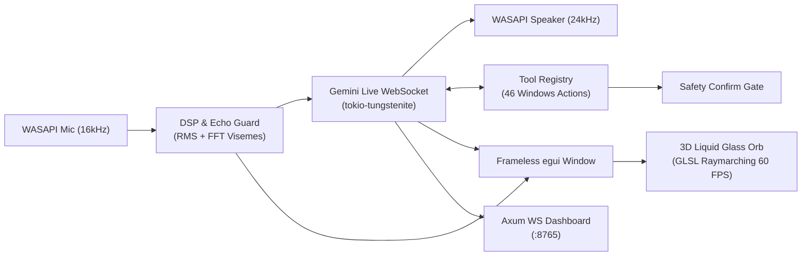

<div align="center">

# Boogie — Native Rust Voice AI Assistant

**Ultra-fast, lightweight real-time voice AI assistant for Windows powered by Gemini Live API & a 60 FPS 3D Liquid Glass GLSL Orb.**


</div>

---

## Why Rust? — Blazing Fast Startup & Tiny RAM Footprint

Boogie was rewritten from the ground up in **pure Rust** to eliminate interpreter overhead, PyQt/Chromium bloat, and sluggish cold starts — while delivering a **60 FPS raymarched 3D GPU interface** and **46 native Windows automation tools** inside a single self-contained `.exe`.

### Visual Performance Comparison

> Measured on Windows 10/11 x64 (`target/release/boogie.exe`, active WASAPI audio streams + OpenGL 3D shader + Gemini Live TLS WebSocket + Axum dashboard server).

```text
⚡ Cold Startup Speed — Launch to Window Ready (shorter is better)
──────────────────────────────────────────────────────────────────────────
Boogie (Rust Native)        █░░░░░░░░░░░░░░░░░░░   0.14s  (137 ms window · 0.74s full GPU+API)
Python + PyQt6              ███████████░░░░░░░░░   2.5 – 4.5s
Electron / Chromium App     ████████████████████   3.5 – 7.0s
```

```text
🧠 Memory Consumption — Active Voice Session (shorter is better)
──────────────────────────────────────────────────────────────────────────
Boogie (Rust Private RAM)   ██░░░░░░░░░░░░░░░░░░   33.3 MB  (~60.8 MB working set w/ GPU + DLLs)
Python + PyQt6              ███████████░░░░░░░░░  240 – 380 MB
Electron / Chromium App     ████████████████████  450 – 800+ MB
```

```text
📦 Footprint on Disk — Ready to Run (shorter is better)
──────────────────────────────────────────────────────────────────────────
Boogie (Single .exe)        ██░░░░░░░░░░░░░░░░░░   26.9 MB  (zero external runtime)
Python + Embedded Env       ████████████░░░░░░░░  350+ MB   (Python + Qt + wheels)
Electron Bundle             ████████████████████  250 – 600 MB
```

### Real Measured Cold-Boot Timeline

| Stage | Elapsed Time | What Happens |
| :--- | :---: | :--- |
| **Process Launch** | `0 ms` | Native binary starts — zero VM/interpreter warmup |
| **WASAPI Audio Ready** | `28 ms` | Native mic (`16 kHz`) & speaker (`24 kHz`) opened via `cpal` |
| **GUI Window Live** | `137 ms` | Frameless Obsidian window visible on screen |
| **Gemini Live Connected** | `~520 ms` | TLS WebSocket `101 Switching Protocols` + session `setupComplete` |
| **3D GPU Orb Rendering** | `~740 ms` | Raymarched Liquid Glass GLSL shader compiled & running at **60 FPS** |

### Side-by-Side Specs

| Metric | Boogie (Rust) | Typical Python + PyQt6 | Typical Electron / WebView |
| :--- | :---: | :---: | :---: |
| **Window Ready** | **~137 ms** | ~2.5 – 4.5 s | ~3.5 – 7.0 s |
| **Private RAM** | **~33 MB** | ~240 – 380 MB | ~450 – 800+ MB |
| **Total Working Set** | **~61 MB** | ~300 – 450 MB | ~550 – 1,000+ MB |
| **Executable Size** | **26.9 MB** (1 file) | 350+ MB (folder) | 250 – 600 MB (folder) |
| **Runtime Needed** | **None** | Python + Qt DLLs | Bundled Chromium + Node |
| **3D Visuals** | **60 FPS GLSL Shader** | CPU / QPainter | WebGL (high RAM) |

---

## Key Features

### 1. Real-Time 3D Liquid Glass / Ferrofluid Orb (`orb_shader.rs`)
- **Pure OpenGL GLSL Raymarching** directly inside `eframe::glow` — zero heavy 3D engine bloat.
- **Audio & Viseme Reactive:** Uses real-time FFT speech analysis (`dsp.rs` — energy level, vowel openness, and formant width) so the 3D fluid surface breathes, ripples, and morphs in sync with speech.
- **Smooth State Morphing:** Fluidly blends palette, turbulence, and orbital ring speed across `Listening` (Violet/Cyan), `Speaking` (Cyan/Mint), `Thinking` (Violet/Amber), `Sleeping`, and `Muted`.
- **Interactive 3D:** Subtle camera/lighting parallax follows your cursor; clicking the orb triggers a liquid energy pulse.

### 2. Modern Frameless Obsidian UI (`gui.rs`)
- **Custom Frameless Window:** Ultra-slim transparent header bar (drag to move, double-click to maximize, full 8-edge resizing), live pulsing status pill, accurate CPU/RAM telemetry, and crisp vector window controls.
- **Live Captions + Frosted Glass Drawer:** Clean centered subtitles fade softly below the orb; click captions or the History button to slide up a translucent glass conversation drawer with modern chat bubbles.
- **Smart Transcript Merging & Tool Chips:** Streaming speech chunks merge into complete sentences; tool invocations render as compact badges (e.g., `⚡ Computer Settings · brightness down`).
- **Floating Glass Control Dock:** Centered pill dock featuring Mute toggle, 14-bar live spectrum visualizer, Interrupt/Stop button, and Conversation Drawer toggle.

### 3. Low-Latency Voice Pipeline & 46 Windows Automation Tools
- **Native WASAPI Audio (`cpal`) + Echo Guard (`echo.rs`):** Smooth barge-in interruption while Boogie is speaking.
- **Gemini Live API (`gemini.rs`):** Native `tokio-tungstenite` WebSocket with session resumption, context injection, proactive check-ins, and stall watchdog.
- **46 Built-in Tools across 16 Modules (`src/actions/`):**
  - **System & Desktop:** Volume, brightness, Wi-Fi, dark mode, lock screen, power, window management, process control (`windows-rs`).
  - **Computer Control:** Native mouse clicks, keyboard typing, hotkeys, screen capture.
  - **Browser Automation:** Chrome DevTools Protocol control (`chromiumoxide`), URL opening, web scraping & search.
  - **Files & Documents:** File operations, Recycle Bin (`trash`), PDF & Excel parsing (`pdf-extract`, `calamine`), clipboard & QR generation.
  - **Media & Daily Utilities:** YouTube search/playback, video/audio player, messaging automation, reminders, flight search, game updater, background topic monitor.
- **Safety Confirmation Gate (`confirm.rs`):** Destructive commands (`shutdown`, `restart`, `kill_process`, `rm -rf`, etc.) pause and display a frosted glass approval modal before executing.
- **Remote WebSocket Dashboard (`dashboard.rs`):** Lightweight `axum` server on `127.0.0.1:8765` (`/ws`, `/health`).

---

## Architecture



---

## Quick Start

### Prerequisites
- **Windows 10 / 11 (64-bit)**
- **Rust toolchain** (Edition 2024 — Rust 1.85+ via [rustup.rs](https://rustup.rs))
- A **Google Gemini API key** with Gemini Live API access

### 1. Clone & Build

```powershell
git clone https://github.com/thodark/Boogie-AI-Assistant.git
cd Boogie-AI-Assistant
cargo build --release
```

### 2. Configure API Key

Boogie reads `config/api_keys.json` located **next to the executable** (`target/release/config/api_keys.json` when running the release binary):

```powershell
mkdir target\release\config -Force
copy config\api_keys.example.json target\release\config\api_keys.json
```

Edit `target/release/config/api_keys.json` and paste your Gemini API key:

```json
{
  "gemini_api_key": "YOUR_GEMINI_API_KEY_HERE",
  "assistant_name": "Boogie",
  "user_name": "Your Name",
  "voice": "Aoede",
  "push_to_talk": false,
  "brief_enabled": true,
  "proactive_audio": true
}
```

### 3. Run

```powershell
.\target\release\boogie.exe
```

Or directly via Cargo:

```powershell
cargo run --release
```

> **Tip:** Set `RUST_LOG=boogie=info` (or `boogie=debug`) to inspect startup timing, audio devices, WebSocket events, and shader initialization.

---

## Project Structure

```text
.
├── Cargo.toml                  # Dependencies & binary target
├── Cargo.lock                  # Reproducible dependency lockfile
├── config/
│   └── api_keys.example.json   # Template config (copy to api_keys.json next to exe)
└── src/
    ├── main.rs                 # Async runtime, audio/WS session loop & confirm routing
    ├── gui.rs                  # Frameless Obsidian UI, captions, glass drawer & dock
    ├── orb_shader.rs           # 60 FPS 3D Liquid Glass / Ferrofluid GLSL shader
    ├── gemini.rs               # Gemini Live API WebSocket client
    ├── audio.rs                # Native WASAPI mic & speaker streams (cpal)
    ├── dsp.rs                  # RMS energy & FFT viseme extraction (rustfft)
    ├── echo.rs                 # Echo guard for clean barge-in
    ├── config.rs               # Config loader, system prompt & memory store
    ├── confirm.rs              # Confirmation safety gate
    ├── proactive.rs            # Proactive check-in engine
    ├── dashboard.rs            # Local Axum WebSocket / health server
    ├── tools.rs                # Tool registry & dispatch
    └── actions/                # 16 modules implementing 46 native Windows tools
```

---

## Running Tests

```powershell
cargo test
```

---

## Tech Stack

| Layer | Crate |
| :--- | :--- |
| **GUI & 3D Shader** | `eframe` / `egui` 0.31 + `glow` (OpenGL GLSL) |
| **Async Runtime** | `tokio` |
| **Audio I/O & DSP** | `cpal` (WASAPI), `rustfft`, `ndarray` |
| **Realtime AI** | `tokio-tungstenite` (Gemini Live WebSocket) |
| **Windows Automation** | `windows` (`windows-rs`), `screenshots`, `arboard`, `trash` |
| **Browser Control** | `chromiumoxide` (CDP), `reqwest`, `scraper` |
| **Local Dashboard** | `axum`, `tower-http` |
